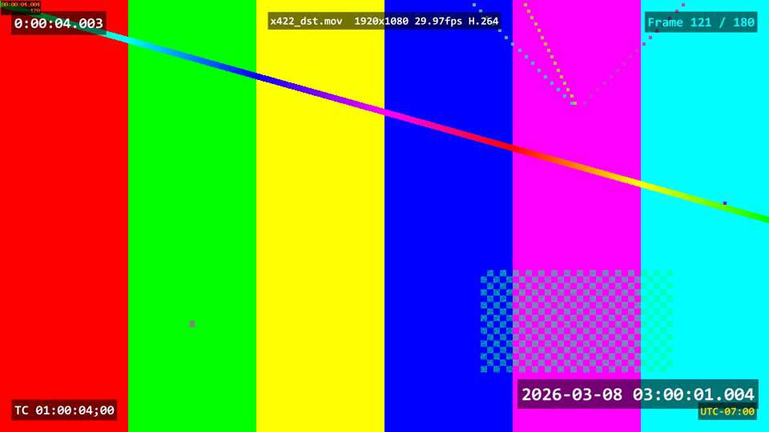
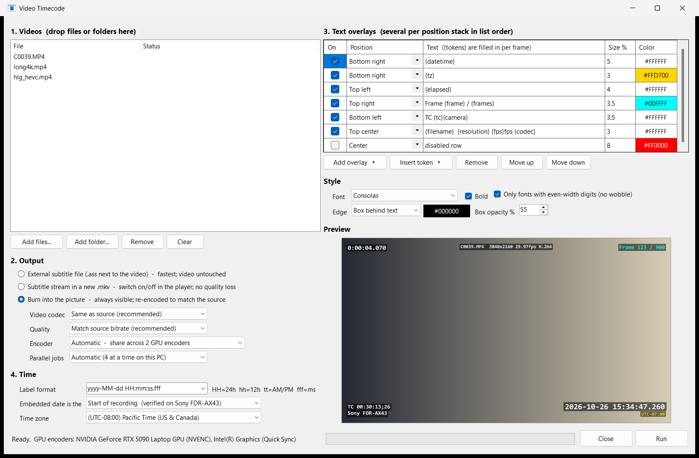

# Video Timecode

Adds a running, **frame-accurate time-of-day timecode** and other text overlays to your
videos, using the recording date the camera embedded in the file. Drop videos on the app,
pick a style, and click Run.





## Features

- **Per-frame, sub-second labels** such as `2026-10-25 15:48:14.033`. Each frame gets its own value.
- **Any number of text overlays**, in any of 9 positions, each with its own size and color. Fill them with tokens:

  | Token | Shows |
  |---|---|
  | `{datetime}` `{date}` `{time}` | recording date/time; add a custom format like `{time:hh:mm:ss tt}` |
  | `{elapsed}` | time since the clip started |
  | `{frame}` `{frames}` | current frame number / total frames |
  | `{tc}` | camera timecode (SMPTE, drop-frame aware) |
  | `{filename}` `{camera}` `{gps}` | file name, camera make/model, GPS location (when recorded) |
  | `{resolution}` `{fps}` `{codec}` `{tz}` | video details, UTC offset |

  Anything else you type is shown as-is (static text).
- **Three output types:**
  - an external `.ass` subtitle file (the video is untouched)
  - a subtitle stream in a new `.mkv` (no quality loss)
  - burned into the picture
- **Burn-in matches the source:**
  - same codec (H.264, HEVC, AV1, ProRes) and bitrate
  - same bit depth and chroma (8/10-bit, 4:2:0/4:2:2)
  - same color tags, including HDR10/HLG and HDR mastering metadata
  - audio is always copied untouched, as are metadata, chapters and camera timecode
- **Uses your GPUs automatically on any PC.** It tests every NVIDIA (NVENC), AMD (AMF) and Intel (Quick Sync) encoder present, checking the real output format, and runs several videos at once across them. If a GPU can't handle a file, that file is retried on another GPU, then on the CPU.
- **Daylight saving time handled** for the recording date, frame by frame across a clock change.
- **Presets:** save any number of named setups, switch between them from the top of the window, and give any preset its own drag-and-drop shortcut. The last run's settings are always available too.

## Download

1. Download `video-timecode-vX.Y.Z.zip` from the [latest release](../../releases/latest) and extract it anywhere.
2. Drag videos (or a folder) onto **`VideoTimecode.exe`**, or open it and add them in the window.

The first time it runs, it offers to download FFmpeg (about 85 MB, from
[BtbN/FFmpeg-Builds](https://github.com/BtbN/FFmpeg-Builds)). The download is checked
against the published SHA-256 checksum and stored in `%LOCALAPPDATA%\VideoTimecode`. If
FFmpeg is already on your PATH, or next to the exe, that copy is used instead.

Requires 64-bit Windows 10 or 11. Nothing else needs installing.

| Drop videos on | What happens |
|---|---|
| `VideoTimecode.exe` | Opens the window. Pick options, click **Run**, and your choices are saved. |
| `Video Timecode - use last settings.bat` | Starts processing right away with the last run's settings |
| `Video Timecode - <preset>.bat` | Starts processing right away with that preset. Create these from **More** in the window. |

## Presets

The **Preset** bar at the top of the window holds your saved setups. A preset stores every
choice in the window: output type, encoding options, overlays, style and time settings.

| Entry | What it is |
|---|---|
| **Last run** | The settings used by the most recent Run, saved automatically. This is what the window opens with. |
| **Defaults** | The factory settings |
| *Your presets* | Saved with **Save as...**. **Save** updates the selected preset with the current settings. |

Choosing an entry loads its settings into the window. **More** has *Rename*, *Delete*, *Open
presets folder*, and **Create drag-and-drop shortcut**. That last option writes
`Video Timecode - <preset>.bat` next to `VideoTimecode.exe`. Drop videos on it to process them
with that preset straight away, without opening the options.

### Where settings are stored

Everything lives in `%LOCALAPPDATA%\VideoTimecode` (for example
`C:\Users\<you>\AppData\Local\VideoTimecode`):

| File | Contents |
|---|---|
| `settings.json` | Last run's settings, written each time you click Run |
| `presets\<name>.json` | One file per preset. Copy these to another PC to share presets. |
| `encoders.json` | Which GPU encoders this PC has (re-checked when the GPUs or FFmpeg change) |
| `last-run.log`, `error.log` | Details of the last run, and of any unexpected errors |
| `ffmpeg\` | FFmpeg, if the app downloaded it |

## Output files

Outputs are written next to each video. Your originals are never changed.

| Output type | Creates |
|---|---|
| External subtitle file | `clip.ass`. VLC and mpv load it automatically with `clip.mp4`. |
| Subtitle stream | `clip_timecode.mkv` (streams copied; turn subtitles on in the player) |
| Burn into picture | `clip_timecode_burned.mp4` / `.mov` / `.mkv` (same container type as the source where possible) |

## Burn-in encoding

With the defaults (**Same as source**, **Match source bitrate**, **Automatic** encoder), each
video is re-encoded as close to the original as possible:

- **Codec:** H.264 stays H.264, HEVC stays HEVC, AV1 stays AV1, ProRes stays ProRes (same profile). Older codecs such as MPEG-2 become H.264, or HEVC for 10-bit and 4:2:2 sources.
- **Bitrate** matches the source's video bitrate. Choose *Higher* (1.5x) or *Smaller file* (0.6x) to trade size for quality.
- **Format:** bit depth, chroma subsampling and color/HDR tags are kept. If no GPU can encode the format (for example 10-bit 4:2:2 on many GPUs), that video goes to the CPU instead of being downgraded.
- **Everything else is copied:** audio tracks, metadata including the recording date (so you can run the tool on its own output), chapters and camera timecode.

### GPUs and parallel jobs

One encode at a time leaves a GPU mostly idle, because the work around the encoder (decoding,
drawing the text) is the bottleneck. Running several at once fixes that. Measured on 30-second 4K clips:

| Setup | Seconds per clip |
|---|---|
| CPU only (x264) | 29.5 |
| 1 job on NVIDIA NVENC | 11.6 |
| 3 jobs at once on NVENC | **4.0** |
| NVENC + CPU together | slower than NVENC alone |

So **Automatic** runs up to 4 videos at once, depending on how many CPU cores the PC has,
spread across all GPU encoders. The CPU is used only when no GPU can produce the format.
You can also pick a specific encoder, *CPU only*, or a fixed number of parallel jobs.

## Where the time comes from

The app uses the first of these it finds:

1. **Sony sidecar XML** (`<clip>M01.XML`): local time plus the camera's own UTC offset.
2. **Apple** `com.apple.quicktime.creationdate`: local time plus offset.
3. **`creation_time`** (UTC): converted using the Windows time zone rules for the recording date. This is the PC's zone unless you choose another one.

Frame times are read from the file itself, so variable-frame-rate phone video stays accurate.

**Start or end of recording?** Most files store the time recording *started*, but not every
device does. On the Sony FDR-AX43 the embedded date is the start: the camera writes the
thumbnail when recording begins and the XML when it stops, and the embedded time matches
the thumbnail. If your device stamps the end, choose *End of recording*. To check a new
device, film a clock that shows seconds and compare it with the timecode.

## Command line

```
VideoTimecode.exe [--use-saved | --preset "Name"] [--exit-when-done] [files or folders...]
```

- `--use-saved` starts straight away with the last run's settings.
- `--preset "Name"` starts straight away with a saved preset.
- `--exit-when-done` closes the window when finished (with either option above), which is handy in scripts.
- The `VIDEO_TIMECODE_HOME` environment variable moves settings, logs and FFmpeg to another folder (e.g. for a portable setup).

## Troubleshooting

- **SmartScreen warns about the exe or `.bat`.** The app isn't code-signed. Choose *More info → Run anyway*, or right-click the zip → *Properties* → *Unblock* before extracting.
- **A video failed.** Click **Open log** at the bottom of the window. It lists the exact ffmpeg command and error for each file.
- **"No recording date found".** Some formats (e.g. `.mpg`) don't store one.
- **Timecode is an hour off.** Check the *Time zone* setting, and that the camera clock was set correctly.

## Building from source

Requires the .NET 10 SDK.

```
cd src/VideoTimecode
dotnet publish -c Release -o ../../dist
```

The previous PowerShell version is in [`legacy-powershell/`](legacy-powershell).

## License

[MIT](LICENSE). FFmpeg, which is downloaded separately at first run, is GPL-licensed. Its
license is saved next to it in `%LOCALAPPDATA%\VideoTimecode\ffmpeg`.
